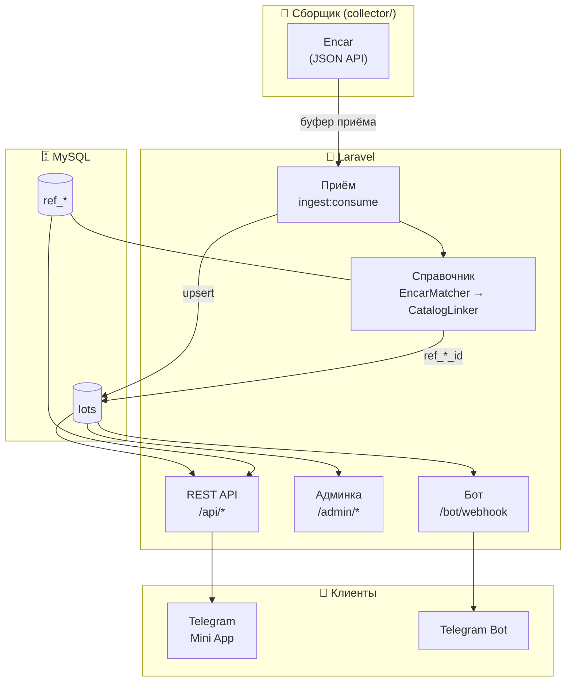
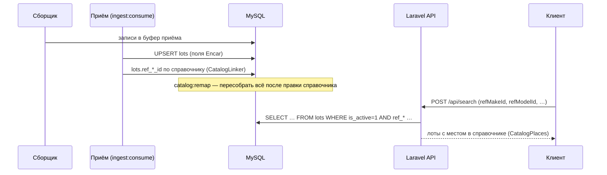

# 01 · Обзор системы

> [Index](./index.md) · **Overview** · [Structure →](./02-structure.md)

---

## Архитектура

---

## Компоненты

| Компонент | Технология | Роль |
|-----------|-----------|------|
| **Сборщик** | Python 3.11 (`collector/`) | Получает лоты с Encar, кладёт записи в буфер приёма |
| **Приём** | Laravel, `ingest:consume` | Пишет записи буфера в `lots`, отбирает по `parse_filters`, сразу ставит новые лоты в справочник |
| **Справочник** | Laravel (`app/Catalog`), JSON `resources/catalog` → `ref_*` | Марка → модель → поколение → модификация → комплектация; см. [13-catalog](./13-catalog.md) |
| **MySQL** | MySQL 8–9 | Хранилище всех данных |
| **Laravel API** | Laravel 13, PHP 8.4 | REST API для Mini App и бота; поиск только по `ref_*` |
| **Admin Panel** | Filament 5 (Livewire 4) | Парсинг по площадкам, лоты, очередь вариантов справочника, правила отбора, доступ |
| **Telegram Mini App** | Vanilla JS | Поиск с каскадом справочника |
| **Telegram Bot** | Laravel + ИИ | Поиск по свободному тексту; названия переводятся в id справочника (`CatalogNames`) |

---

## Поток данных

---

## Ключевые принципы

| Принцип | Реализация |
|---------|-----------|
| **Только то, что сказал Encar** | Двигатель, привод, топливо, поколение — только из полей Encar; неизвестное остаётся пустым, в фильтре видно как «не указано» |
| **Названия — из справочника** | Марка, модель, поколение, модификация, комплектация — `ref_*`; ИИ-переводов в данных нет |
| **Поля Encar не переписываются** | Корейские `make`, `model`, `badge`, `trim` хранятся как прислал Encar; непустое новое значение заменяет старое |
| **Фазовые фильтры** | PRE (до записи в БД) и POST (после инспекции) — разные уровни фильтрации |
| **Кэш метаданных** | Python-схема полей экспортируется в JSON-файл, не вызывается subprocess в web-запросах |

---

[Index](./index.md) · [Structure →](./02-structure.md)
