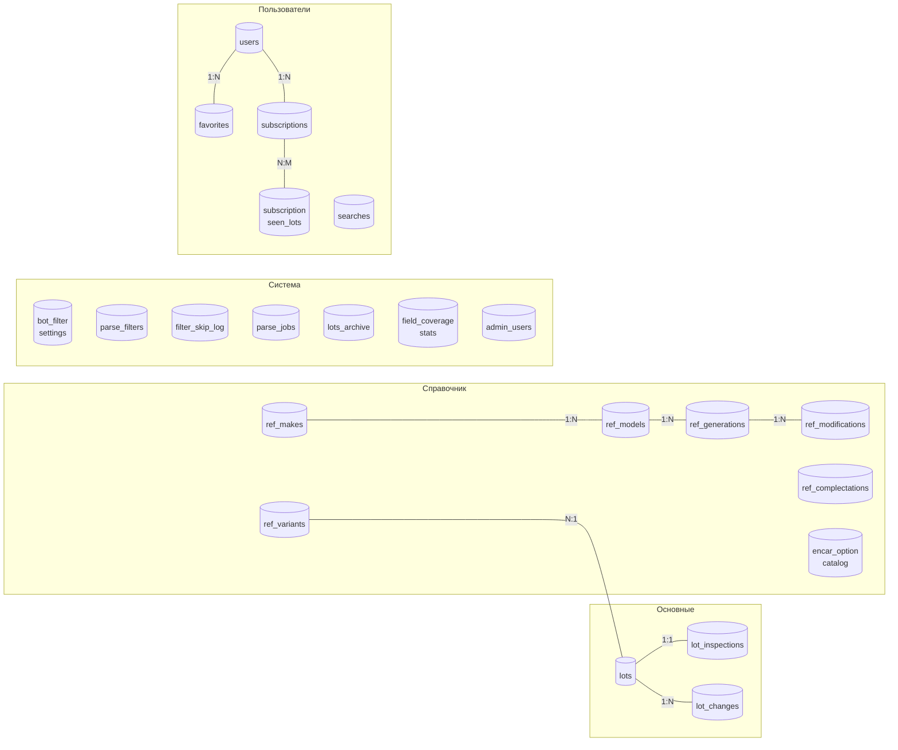

# 03 · База данных

> [← Structure](./02-structure.md) · [Index](./index.md) · [Parser →](./04-parser.md)

---

## Группы таблиц

---

## Таблица `lots` — иерархия Encar iNav

Encar организует данные в 6 уровней (iNav). Лот хранит их как прислал Encar, по-корейски:

| Уровень | Колонка | Пример |
|---------|---------|--------|
| 1 · Марка | `make` | `현대` |
| 2 · ModelGroup | `model_group` | `쏘나타` |
| 3 · Model (вариант) | `model` (полное название — `raw_data.model_kr_raw`) | `쏘나타 디 엣지(DN8)` |
| 4 · BadgeGroup | `badge_group` | `가솔린 2000cc` |
| 5 · Badge | `badge` | `2.0 터보` |
| 6 · BadgeDetail | `trim`, английское от Encar — `trim_en` | `프레스티지` / `Prestige` |

Английские названия марки, модели, поколения, модификации и комплектации — только из справочника
(`ref_*`, см. [13-catalog](./13-catalog.md)): лот ссылается на него колонками `ref_*_id`.

---

## Таблица `lots` — все колонки

| Колонка | Тип | Описание |
|---------|-----|----------|
| `id` | VARCHAR(100) PK | ID лота из источника |
| `source` | VARCHAR(20) | `encar` \| `kbcha` |
| `make` | VARCHAR(60) | Марка (корейская) |
| `model` | VARCHAR(60) | Модель Level-3 (корейская) |
| `model_group` | VARCHAR(100) | ModelGroup Level-2 (корейская) |
| `badge` | VARCHAR(150) | Badge Level-5 (корейская) |
| `badge_group` | VARCHAR(150) | BadgeGroup Level-4 (корейская) |
| `trim` | VARCHAR(40) | BadgeDetail Level-6 (корейская комплектация) |
| `trim_en` | VARCHAR(100) | BadgeDetail по-английски, как прислал Encar (`gradeDetailEnglishName`) |
| `year` | SMALLINT | Год выпуска |
| `price` | INT | Цена в KRW |
| `mileage` | INT | Пробег в км |
| `fuel` | VARCHAR(20) | `gasoline` \| `diesel` \| `hybrid` \| `electric` \| `lpg` |
| `drive_type` | VARCHAR(10) | `fwd` \| `rwd` \| `awd` \| `4wd` |
| `body_type` | VARCHAR(30) | `sedan` \| `suv` \| `hatchback` \| `wagon` \| `coupe` \| `van` |
| `engine_volume` | FLOAT | Объём двигателя (литры) |
| `seat_count` | TINYINT | Количество мест |
| `transmission` | VARCHAR(20) | Тип КПП (`automatic` \| `manual` \| `cvt` \| `dct`) |
| `color` | VARCHAR(30) | Цвет кузова (английский) |
| `seat_color` | VARCHAR(30) | Цвет салона (английский) |
| `has_accident` | BOOLEAN | ДТП по страховой истории или найденное осмотром; «без ДТП» — только вместе с `insurance_count = 0`, см. [04-parser](./04-parser.md#дтп-страховая-история-против-осмотра) |
| `flood_history` | BOOLEAN | История затопления |
| `total_loss_history` | BOOLEAN | Признание тотальным убытком |
| `owners_count` | SMALLINT | Количество владельцев |
| `insurance_count` | SMALLINT | Количество страховых случаев |
| `repair_cost` | INT | Стоимость ремонта по страховым (KRW) |
| `retail_value` | INT | Цена нового ТС (KRW) |
| `lien_status` | VARCHAR(20) | Залог/обременение (`clean` \| `lien`) |
| `seizure_status` | VARCHAR(20) | Статус ареста (`clean` \| `seizure`) |
| `sell_type` | VARCHAR(30) | `dealer` \| `private` \| `auction` \| `rental` \| `lease` |
| `vin` | VARCHAR(20) | VIN |
| `plate_number` | VARCHAR(20) | Номерной знак |
| `first_reg_date` | DATE | Дата первой регистрации |
| `listed_at` | TIMESTAMP | Дата публикации объявления |
| `lot_url` | VARCHAR(500) | Ссылка на объявление |
| `image_url` | VARCHAR(500) | Первое фото |
| `photo_dir` | TINYINT | Галерея по шаблону Encar: `carpicture{NN}` |
| `photo_base_id` | INT | Id фото в имени файла (≠ id лота у перевыставленных) |
| `photo_codes` | VARCHAR | Коды фото по порядку: `021,001,009`; `''` если используется `photo_urls` |
| `photo_ext_upper` | BOOLEAN | `.JPG` вместо `.jpg` |
| `photo_urls` | JSON | Явный список URL для фото вне шаблона (KBChacha и т.п.) |
| `location` | VARCHAR(100) | Регион/город |
| `options` | JSON | Коды опций Encar (`["001","014",…]`) |
| `options_mask` | BIGINT UNSIGNED | Те же коды битами (`encar_option_catalog.bit`); поиск: `(options_mask & m) = m` |
| `paid_options` | JSON | Платные опции |
| `raw_data` | JSON | Сырые поля Encar, которых нет в колонках (`model_kr_raw`, `ad_status`, …) |
| `ref_variant_id` | INT | Вариант Encar в справочнике (`ref_variants`, хэш полей Encar) |
| `ref_make_id` … `ref_complectation_id` | INT | Место в справочнике: марка, модель, поколение, модификация, комплектация; NULL — не указано |
| `is_active` | BOOLEAN | `0` = отфильтрован `parse_filters` или снят с продажи (не найден последним успешным полным прогоном, см. [04-parser](./04-parser.md#жизненный-цикл-лота)) |
| `parsed_at` | TIMESTAMP | Время парсинга |
| `history_checked_at` | TIMESTAMP | Когда парсер последний раз получил историю (record + inspection), UTC; очередь перепроверки, см. [04-parser](./04-parser.md#история-лота-не-каждый-прогон) |
| `expires_at` | TIMESTAMP | Время истечения актуальности |

---

## Справочник (`ref_*`)

Пишется из `resources/catalog/reference/*.json` командой `catalog:remap`; подробно — [13-catalog](./13-catalog.md).

| Таблица | Назначение |
|---------|-----------|
| `ref_makes`, `ref_models`, `ref_generations`, `ref_modifications`, `ref_complectations` | Марка → модель → поколение (код, годы) → модификация (код, топливо, привод) → комплектация |
| `ref_variants` | Вариант Encar (хэш `make, model, badge_group, badge, trim`): статус `matched` / `no_engine` / `unmatched`, место в справочнике, ручная разметка, число активных лотов |

---

## `encar_option_catalog`

Справочник опций Encar: код → названия на KR/EN/RU.

| Колонка | Описание |
|---------|----------|
| `code` | PRIMARY KEY (`"001"`, `"014"`) |
| `name_kr` | Корейское название (`선루프`) |
| `name_en` | Английское (`Sunroof`) |
| `name_ru` | Русское (`Люк`) |
| `bit` | Бит в `lots.options_mask` (стабильный; новые коды получают следующий в `options:import-encar`) |
| `icon_url` | URL иконки Encar |
| `category` | `exterior` \| `safety` \| `convenience` \| `interior` |

Заполняется: `options:import-encar` (коды) + `options:name-by-ai` (переводы).

---

## Системные таблицы

| Таблица | Назначение |
|---------|-----------|
| `bot_filter_settings` | Настройки полей бот-поиска (tolerance, отображение в карточке) |
| `parse_filters` | Правила PRE/POST фильтрации лотов |
| `filter_skip_log` | Лог отфильтрованных лотов |
| `parse_jobs` | История запусков парсера и статистика |
| `field_coverage_stats` | Процент заполненности каждого поля |
| `admin_users` | Пользователи админ-панели |
| `subscription_seen_lots` | Просмотренные лоты по подпискам |
| `lots_archive` | Компактная строка (~200 байт) удалённого `lots:lifecycle` лота: `id, source, make_name, model_name, generation_name, ref_*_id, year, mileage, price, first_seen, last_seen, sold_detected_at` — история цен проданных машин. Названия и `ref_*_id` — из справочника на момент удаления; строки, архивированные до 2026-10-25, хранят старые переводы и `ref_*_id = NULL` |
| `notification_recipients` | Получатели Telegram-уведомлений админам: chat id, типы, флаг enabled |
| `notification_settings` | Пороги уведомлений (key → value) |
| `notification_events` | Дедупликация: отправленные события и открытые/закрытые инциденты |
| `notification_log` | Каждая попытка отправки уведомления |

---

[← Structure](./02-structure.md) · [Index](./index.md) · [Parser →](./04-parser.md)
