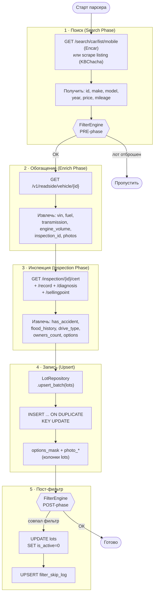

# 04 · Парсер (Python)

> [← Database](./03-database.md) · [Index](./index.md) · [Catalog →](./05-catalog.md)

---

## Запуск

```bash
python parser/main.py                             # планировщик (непрерывно)
python parser/main.py --once                      # разовый прогон всех источников
python parser/main.py --once --maker 현대 --pages 5
python parser/main.py --once --limit 100
python parser/main.py --reenrich                  # повторно обогатить уже имеющиеся лоты
python parser/main.py --debug                     # подробный лог
```

---

## Фазы парсинга



### История лота: не каждый прогон

Фаза 3 (record + inspection + sellingpoint) — до трёх запросов на лот и около 2/3 времени
полного прогона. У уже известных лотов эти данные почти не меняются: по `lot_changes` за
полтора дня число владельцев изменилось у 0,24% лотов, остальные поля истории — у ≤0,1%.
Поэтому полный прогон (`run()`) спрашивает историю не у всех:

| Лот | Запросы | Откуда история |
|-----|---------|----------------|
| новый (`history_checked_at` пуст) | record + inspection + sellingpoint | API |
| пришла очередь, сменился `condition` списка или в `lots` нет истории | record + inspection | API; привод из БД |
| проверен недавно | нет | БД (`_apply_stored`) |

- **Очередь.** В начале прогона `history_cutoff` берёт `history_checked_at` самой старой
  1/`ENCAR_HISTORY_EVERY_RUNS` активных лотов (по умолчанию 3). Перепроверяются те, кто
  проверен раньше: каждый лот примерно раз в 3 прогона; лоты из упавшего прогона остаются
  самыми старыми и уходят в следующий. `ENCAR_HISTORY_EVERY_RUNS=1` — старое поведение.
- **Значения из БД** (`_HISTORY_FIELDS`, `_HISTORY_RAW_KEYS`) кладутся на `CarLot` до
  записи, поэтому PRE-фильтры (например `max_insurance_count`), upsert и `lot_changes`
  видят тот же лот, что после настоящего запроса. Тест `test_history_refresh.py` падает,
  если `_enrich_from_record` / `_enrich_from_inspection` начнут писать новые поля.
- **«Нет истории в `lots`»**: лоты, которые PRE-фильтр отбрасывает после record (их
  история в `lots` не пишется) — перепроверяются каждый прогон.
- `history_checked_at` ставится только лотам, у которых все запросы прошли и запись
  удалась. `run_reparse` и `run_sample` всегда спрашивают историю.
- В `result` задачи: `history_fetched`, `history_stored`.

> **Сборщик (`collector/`)** хранит историю в своей `collector.lot_history`. Правила те же, кроме трёх:
> - История отклонённых лотов тоже сохраняется, и их больше не перекачивают каждый прогон.
> - Вместе с историей запоминаются пробег, цена и номер объявления. Если что-то из этого изменилось, история скачивается заново, не дожидаясь очереди: продавец обновил машину, и мог появиться новый страховой случай или осмотр.
> - В `result` добавлено поле `history_listing_changed` — сколько лотов перекачано по этой причине.

---

## `CarLot` — датакласс

Каноническое in-memory представление лота. Поля 1:1 соответствуют колонкам таблицы `lots`.

```python
@dataclass
class CarLot:
    # Идентификация
    id:          str
    source:      str          # 'encar' | 'kbcha'
    make:        str          # марка (корейская)
    model:       str          # модель (корейская)
    year:        int
    price:       int          # KRW

    # Пробег
    mileage:     int = 0

    # Технические характеристики
    fuel:         str | None = None   # 'gasoline' | 'diesel' | 'hybrid' | ...
    transmission: str | None = None
    body_type:    str | None = None
    drive_type:   str | None = None
    engine_volume: float | None = None
    cylinders:    int | None = None
    seat_count:   int | None = None
    color:        str | None = None

    # Таксономия (заполняется нормализацией Laravel)
    trim:        str | None = None
    generation:  str | None = None
    variant:     str | None = None
    package:     str | None = None

    # Документы
    vin:              str | None = None
    plate_number:     str | None = None
    first_reg_date:   str | None = None
    listed_at:        str | None = None

    # История
    has_accident:        bool | None = None
    flood_history:       bool | None = None
    total_loss_history:  bool | None = None
    owners_count:        int  | None = None
    insurance_count:     int  | None = None

    # Стоимость
    retail_value:  int | None = None
    repair_cost:   int | None = None

    # Ссылки
    lot_url:   str = ""
    image_url: str | None = None
    location:  str | None = None

    # Продажа
    sell_type:     str | None = None
    sell_type_raw: str | None = None

    # Фото → компактные колонки lots.photo_* (НЕ попадают в raw_data)
    photos: list[str] | None = None

    # Сырые API-данные (всё остальное)
    raw_data: dict = field(default_factory=dict)
```

> **_RAW_DATA_BLOCKLIST** — поля, которые **не** сериализуются в `raw_data`:
> `photos`, `photo_count`, `sell_type`, `manufacturer_kr`, `model_en`, `model_group_kr`, `year_month`, `origin_price`, `seat_count`

---

## `LotRepository` — интерфейс к БД

| Метод | Описание |
|-------|----------|
| `upsert_batch(lots)` | INSERT + ON DUPLICATE KEY UPDATE; пишет `options_mask` и `photo_*` (см. `lot_compact.py`) |
| `_apply_filters(lots, stats)` | PRE-фаза FilterEngine — удаляет лоты из памяти до записи |
| `apply_post_filters(lot_ids)` | POST-фаза FilterEngine — ставит `is_active=0` в БД |
| `_get_filter_engine()` | Ленивая загрузка + кэш правил (обновляется каждые 60 с) |
| `_deactivate_existing(lot_ids)` | Ставит `is_active=0` лотам, которые исключили фильтры |
| `delist_not_seen_since(source, since)` | Ставит `is_active=0` активным лотам с `parsed_at < since` (пачками по 2000), пишет `lot_changes` `delisted` |

---

## Планировщик

APScheduler запускает каждый парсер по настроенному интервалу (обычно 1–2 ч).

- Запуски **не перекрываются**: если предыдущий ещё работает, следующий тик пропускается
- Статистика каждого запуска пишется в `parse_jobs`: `total`, `new`, `updated`, `filtered`, `errors`

---

## Жизненный цикл лота

Проданные машины исчезают из выдачи Encar. Лот проходит три состояния:
**активен → скрыт (`is_active=0`) → удалён (остаётся строка в `lots_archive`)**.

Всё считается в **успешных полных прогонах**, а не в днях. Если парсер простаивает
(однажды он стоял 4 месяца), ничего не скрывается и не удаляется.

**Успешный полный прогон** — строка `parse_jobs`, у которой:
- `type=full`, `status=done`;
- нет фильтров `maker` / `max_pages`;
- `result.coverage_pct >= LOTS_LIFECYCLE_MIN_COVERAGE` (по умолчанию 85);
- `result.full_run` не равен `false`. Парсер пишет туда своё решение; у старых строк поля нет.

`coverage_pct` = обработано / `Count` из API Encar. Правило реализовано дважды, держите копии одинаковыми:
- в парсере: [`parser/lifecycle.py`](../parser/lifecycle.py);
- в Laravel: `App\Services\LotLifecycle`.

**«Лот видели в прогоне»** = `parsed_at >= начало прогона`: upsert ставит `parsed_at = now`
каждому лоту, который прогон увидел. Начало прогона парсер пишет в `result.run_started_at`
(UTC). У старых строк вместо него берётся `created_at` (момент постановки в очередь); это
раньше реального старта, поэтому скрывается меньше, а не больше.

| Шаг | Где | Когда | Что делает |
|-----|-----|-------|------------|
| **Delist** | `EncarParser.run()` → `delist_unseen()` | В конце каждого успешного полного прогона | `is_active=0` лотам с `parsed_at < run_started_at`, `lot_changes` `delisted`. Лот, который снова попал в выдачу, upsert активирует обратно (`relisted`) |
| **Delist (догоняющий)** | `lots:lifecycle` | Каждый час | То же по последнему успешному прогону, если парсер этот шаг не выполнил |
| **Purge** | `lots:lifecycle` | Каждый час | Неактивные лоты, которых не было в последних `LOTS_PURGE_AFTER_RUNS` (5) успешных прогонах: строка в `lots_archive`, потом удаление лота вместе с детьми |

Purge:
- `lot_photos`, `lot_inspections`, `lot_changes` удаляются каскадом по FK; `lot_options` FK не имеет и удаляется явно;
- лоты из `favorites` не удаляются никогда;
- удаляет пачками по 2000 лотов, одна транзакция на пачку, пауза 200 мс между ними;
- пока есть `parse_jobs` со статусом `running`, команда ничего не пишет;
- если прогон стартовал во время работы команды, она останавливается после текущей пачки.

Команда и `--dry-run`: см. [11-commands](./11-commands.md#lotslifecycle).

> Частичные прогоны (`--maker`, `--pages`), прогоны с покрытием ниже порога и KBChacha,
> возобновлённая с checkpoint, ничего не скрывают. Раньше delist срабатывал только при
> покрытии ≥ 95% и строил `NOT IN (200k id)`; на деле он почти никогда не срабатывал.

---

## Источники

| Ключ | Платформа | Метод | Особенности |
|------|----------|-------|-------------|
| `encar` | [Encar](https://www.encar.com) | JSON API (`api.encar.com`) | Инспекция доступна только для сертифицированных авто |
| `kbcha` | [KBChacha](https://www.kbcha.com) | Scraper (httpx + XHR intercept) | Нужен User-Agent rotation; прокси для продакшена |

---

[← Database](./03-database.md) · [Index](./index.md) · [Catalog →](./05-catalog.md)
