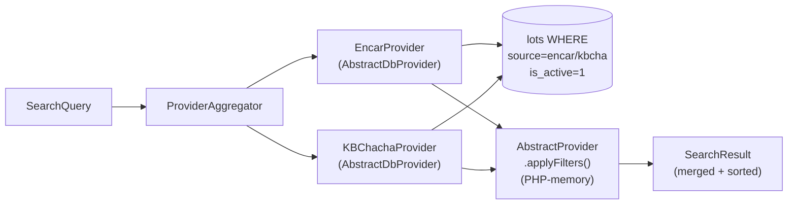
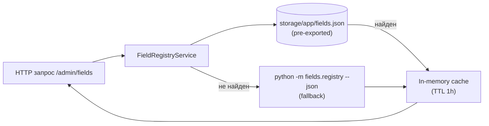

# 08 · API & Admin Panel

> [← Taxonomy](./07-taxonomy.md) · [Index](./index.md) · [Bot →](./09-bot.md)

---

## REST API (`/api/`)

### Публичные endpoints

| Метод | Путь | Описание |
|-------|------|----------|
| `GET` | `/api/filters` | Марки, модели, источники, значения полей |
| `GET` | `/api/filters/context` | Динамический контекст фильтров для текущей выборки |
| `GET` | `/api/filters/trims` | Автодополнение трима |
| `GET` | `/api/lots/{id}/inspection` | Детали инспекции лота |

### Защищённые endpoints (Telegram auth)

Middleware `ValidateTelegramAuth` проверяет HMAC-подпись `initData` от Telegram WebApp.

| Метод | Путь | Описание |
|-------|------|----------|
| `POST` | `/api/search` | Поиск лотов с фильтрами |
| `GET` | `/api/favorites` | Список избранных лотов |
| `POST` | `/api/favorites` | Добавить лот в избранное |
| `DELETE` | `/api/favorites/{id}` | Удалить из избранного |
| `GET` | `/api/subscriptions` | Активные подписки мониторинга |
| `POST` | `/api/subscriptions` | Создать подписку |
| `DELETE` | `/api/subscriptions/{id}` | Удалить подписку |
| `POST` | `/api/subscriptions/{id}/seen` | Пометить новые лоты как просмотренные |

---

## Провайдерный слой



`AbstractDbProvider` строит SQL-запрос с основными фильтрами (make, model, year, price, mileage).  
`AbstractProvider.applyFilters()` — финальная PHP-фильтрация в памяти для сложных условий (bool-комбинации, tolerance-диапазоны, массивы значений).

---

## Админ-панель (`/admin/`, Filament)

Filament 5 (Livewire 4), `App\Providers\Filament\AdminPanelProvider`. В 2026-10 заменила Blade-админку; старые адреса
(`/admin/jobs`, `/admin/bot-filters`, `/admin/users`, `/panel/*` …) перенаправляются на новые страницы (`routes/web.php`).

- **Вход** — `admin_users`, guard `admin` (`config/auth.php`), вход по логину. Роль `super` видит всё; `limited` — разделы,
  включённые в `admin_page_permissions` (`AdminUser::canSeePage()`, правится на странице «Доступ к админке»).
- **Меню**: Работа (Обзор, Лоты) · Площадки (по пункту на каждый `source`) · Данные · Поиск и команда · Система.

| Страница | Класс | Ключ права | Что делает |
|----------|-------|-----------|------------|
| `/admin` Обзор | `Pages\Overview` + виджеты | `dashboard` | Площадки: активные лоты и график 14 дней (точки — `result.db_count` прогонов), последний успешный полный прогон (правила `lots:lifecycle`), новые и снятые за 24 ч, заполненность полей; открытые инциденты; балансы прокси и DeepSeek (последняя проверка `notifications:watch`, если старше часа — запрос к API) |
| `/admin/lots` Лоты | `Resources\Lots\LotResource` | `lots-browse` (перепарсинг — `lots`) | Таблица с фильтрами-чипами и вкладками (Все активные, Новые сегодня, Снятые за 24 ч, Без комплектации, Все; счётчики грузятся после таблицы), поиск по ID (префикс), VIN, госномеру, `model_en`; карточка справа и `/admin/lots/{id}`: Данные, История (`lot_changes`), Осмотр, Сырые данные; «Перепарсить» (до 500 лотов, `App\Services\LotReparseQueue` → `parse_jobs` `type=reparse`) |
| `/admin/platforms/{source}` Площадка | `Pages\Platform` + `Livewire\Platform\*` | `jobs`, `schedules`, `filters`, `filter-skip-log`, `fields` по вкладкам | «Прогоны»: текущий прогон (опрос раз в 5 с), «Остановить», история с пометкой «засчитан», подробности и хвост лога задачи; «Запустить парсинг» — полный, тестовый (5 страниц) или выбранные марки (по задаче на марку) с оценкой трафика прокси. «Расписание» (`parser_schedules`). «Правила отбора» (`parse_filters`: фразой, порядок перетаскиванием = `priority`, группы И, значения по типу поля, имя генерируется, сколько активных лотов попадёт, срабатывания из `filter_skip_log`). «Лог пропусков». «Поля» (`field_coverage_stats`) |
| `/admin/translation-review` Проверка переводов | `Pages\TranslationReview` | `taxonomy` | Очередь словаря KR→EN: «Ждут проверки» (`source=ai`), «Проверены», «Без перевода»; клавиши J/K, A, E, D. Исправление пишется в лоты со старым переводом или пустым полем, отклонение очищает их, чтобы `translate:run` перевёл заново (`App\Services\TranslationCatalog`). Заменяет очередь аномалий старого regex-пайплайна (таблицы удалены 2026-06-01) |
| `/admin/translations` Переводы | `Resources\Translations\TranslationResource` | `taxonomy` | Весь словарь `translations` с правкой, добавлением, удалением |
| `/admin/encar-options` Опции Encar | `Resources\EncarOptions\EncarOptionResource` | `taxonomy` | Названия и группы опций (`encar_option_catalog`), после правки сбрасывается кэш каталога |
| `/admin/field-coverage` Покрытие полей | `Pages\FieldCoverage` | `fields` | Матрица поле × площадка, «Пересчитать» (`fields:compute-coverage`) |
| `/admin/lot-changes` Изменения лотов | `Resources\LotChanges\LotChangeResource` | `changes` | `lot_changes` с фильтрами (период, событие, поле, площадка), график по дням и самые изменчивые лоты |
| `/admin/search-settings` Настройки поиска | `Pages\SearchSettings` | `bot-filters` | `bot_filter_settings`: основные поля и «Все поля», допуск «±1 год / ±10 %», в карточке; каждая строка сохраняется сразу; проверка разбора запроса (через AI); сброс к умолчаниям |
| `/admin/pickers` Подборщики | `Resources\BotUsers\BotUserResource` | только `super` | Пользователи бота (`users`) с числом поисков, избранного, подписок и их последними записями |
| `/admin/admin-users` Доступ к админке | `Resources\AdminUsers\AdminUserResource` | только `super` | Администраторы, роли, пароли; что видит роль `limited` |
| `/admin/notifications` Уведомления | `Pages\Notifications` | только `super` | См. ниже |
| `/admin/logs` Логи | `Pages\Logs` | `logs` (очистка — `super`) | Лог парсера и его ротации, логи задач, `storage/logs/laravel*.log`; уровень, поиск, автообновление, скачивание |

**Тема** — `resources/css/filament/panel/theme.css` (Tailwind v4), шрифт Onest лежит на нашем сервере. Собирается
`npm run build:panel` в `public/css/filament/panel/` (на деплое — стадия `panel-assets` в `Dockerfile`). Ассеты самого
Filament публикует `php artisan filament:upgrade` (скрипт composer `post-autoload-dump`). PHP-расширения `intl` и `zip` обязательны.

### Уведомления (`/admin/notifications`)

Настройка Telegram-уведомлений, которые рассылает [`notifications:watch`](./11-commands.md#notificationswatch). Доступна только роли `super`.

- **Получатели** (`notification_recipients`). Можно ввести chat id (число, для групп с минусом, или `@channel`) или выбрать пользователя бота из `users`; chat id личного чата равен Telegram id пользователя. У каждого получателя есть флаг «включён» и свой набор типов. Владелец (@archi10764, `799255534`) создаётся миграцией.
- **Кнопка «Отправить тест»** шлёт пробное сообщение. Бот может писать только тем, кто хоть раз нажал `/start`. Ошибку Telegram страница показывает как есть, без токена.
- **Пороги** (`notification_settings`, значения по умолчанию в `config/notifications.php`): шаг прогресса и интервал, через сколько минут задача считается «зависшей», минимум ГБ прокси и дни до конца подписки, минимум $ на DeepSeek, сколько часов допустимо без успешного прогона, интервал повторов для открытых алертов.
- **Статус** последней проверки (БД, FloppyData, DeepSeek), открытые инциденты (`notification_events`) и последние 40 отправок (`notification_log`).

| Тип | Когда | По умолчанию |
|-----|-------|:---:|
| `jobs.started` | задача `parse_jobs` перешла в `running` | ✅ |
| `jobs.progress` | каждые 25 % лотов и не реже раза в 2 ч | ✅ |
| `jobs.finished` | `done`: лоты, скорость, новые / обновлено / отфильтровано / устарело, ошибки, ГБ прокси | ✅ |
| `jobs.failed` | `error`, `cancelled`, `interrupted`, нет записи ≥ 15 мин; плюс сообщение о восстановлении | ✅ |
| `infra.db_down` | MySQL не отвечает; плюс сообщение о восстановлении | ✅ |
| `balance.proxy_low` | FloppyData меньше X ГБ, подписка истекает в течение 3 дней или API баланса падает 3 раза подряд | ✅ |
| `balance.ai_low` | DeepSeek меньше $1 (проверяется, только если `AI_API_URL` указывает на DeepSeek) | ✅ |
| `parser.no_recent_run` | нет успешного полного прогона дольше N ч | — (opt-in) |

Задачи типа `reparse` не оповещаются.

---

## FieldMappingsService / FieldRegistryService

Эти сервисы предоставляют PHP-слою метаданные из Python-парсера.



Экспорт обновляется командой `php artisan export:fields-schema` и коммитится в репо — Railway-деплои не требуют Python в runtime.

---

## Мини-приложение (`/miniapp/`)

Статическая Telegram Mini App (Vanilla JS).

```
GET /miniapp/         → index.html
JS модули:
  telegram.js    Инициализация Telegram.WebApp SDK
  api.js         Fetch-обёртки для /api/*
  filters.js     Логика панели фильтров
  results.js     Рендер карточек лотов
  app.js         Точка входа, координация
```

Авторизация: Mini App передаёт `initData` в заголовке `X-Telegram-Init-Data`, middleware проверяет HMAC.

---

[← Taxonomy](./07-taxonomy.md) · [Index](./index.md) · [Bot →](./09-bot.md)
