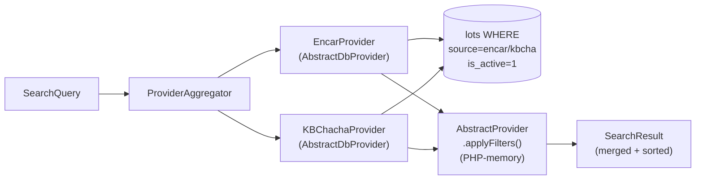
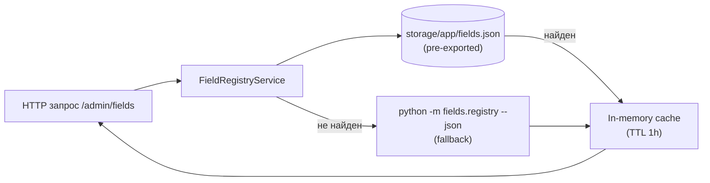

# 08 · API & Admin Panel

> [← Taxonomy](./07-taxonomy.md) · [Index](./index.md) · [Bot →](./09-bot.md)

---

## REST API (`/api/`)

### Публичные endpoints

| Метод | Путь | Описание |
|-------|------|----------|
| `GET` | `/api/filters` | Марки, модели, источники, значения полей |
| `GET` | `/api/filters/context` | Динамический контекст фильтров для текущей выборки |
| `GET` | `/api/filters/trims` | Автодополнение трима |
| `GET` | `/api/lots/{id}/inspection` | Детали инспекции лота |

### Защищённые endpoints (Telegram auth)

Middleware `ValidateTelegramAuth` проверяет HMAC-подпись `initData` от Telegram WebApp.

| Метод | Путь | Описание |
|-------|------|----------|
| `POST` | `/api/search` | Поиск лотов с фильтрами |
| `GET` | `/api/favorites` | Список избранных лотов |
| `POST` | `/api/favorites` | Добавить лот в избранное |
| `DELETE` | `/api/favorites/{id}` | Удалить из избранного |
| `GET` | `/api/subscriptions` | Активные подписки мониторинга |
| `POST` | `/api/subscriptions` | Создать подписку |
| `DELETE` | `/api/subscriptions/{id}` | Удалить подписку |
| `POST` | `/api/subscriptions/{id}/seen` | Пометить новые лоты как просмотренные |

---

## Провайдерный слой



`AbstractDbProvider` строит SQL-запрос с основными фильтрами (make, model, year, price, mileage).  
`AbstractProvider.applyFilters()` — финальная PHP-фильтрация в памяти для сложных условий (bool-комбинации, tolerance-диапазоны, массивы значений).

---

## Админ-панель (`/admin/`)

Защищена middleware `admin.auth` (сессия `AdminUser`).

| Страница | Контроллер | Назначение |
|----------|-----------|------------|
| `/admin/lots` | `AdminLotsController` | Просмотр и поиск по таблице `lots` |
| `/admin/taxonomy/rules` | `TaxonomyRulesController` | Управление `taxonomy_rules` |
| `/admin/bot-filters` | `BotFiltersController` | Настройка полей бот-поиска |
| `/admin/filters` | `ParseFiltersController` | PRE/POST правила фильтрации |
| `/admin/filter-skip-log` | — | Лог отфильтрованных лотов |
| `/admin/parser/jobs` | `ParserJobsController` | История запусков парсера |
| `/admin/fields` | `FieldsController` | Браузер реестра полей |
| `/admin/logs` | `LogsController` | Просмотр логов приложения |
| `/admin/notifications` | `NotificationsController` | Telegram-уведомления админам (только super) |

### Уведомления (`/admin/notifications`)

Настройка Telegram-уведомлений, которые рассылает [`notifications:watch`](./11-commands.md#notificationswatch). Доступна только роли `super`.

- **Получатели** (`notification_recipients`). Можно ввести chat id (число, для групп с минусом, или `@channel`) или выбрать пользователя бота из `users`; chat id личного чата равен Telegram id пользователя. У каждого получателя есть флаг «включён» и свой набор типов. Владелец (@archi10764, `799255534`) создаётся миграцией.
- **Кнопка «Отправить тест»** шлёт пробное сообщение. Бот может писать только тем, кто хоть раз нажал `/start`. Ошибку Telegram страница показывает как есть, без токена.
- **Пороги** (`notification_settings`, значения по умолчанию в `config/notifications.php`): шаг прогресса и интервал, через сколько минут задача считается «зависшей», минимум ГБ прокси и дни до конца подписки, минимум $ на DeepSeek, сколько часов допустимо без успешного прогона, интервал повторов для открытых алертов.
- **Статус** последней проверки (БД, FloppyData, DeepSeek), открытые инциденты (`notification_events`) и последние 40 отправок (`notification_log`).

| Тип | Когда | По умолчанию |
|-----|-------|:---:|
| `jobs.started` | задача `parse_jobs` перешла в `running` | ✅ |
| `jobs.progress` | каждые 25 % лотов и не реже раза в 2 ч | ✅ |
| `jobs.finished` | `done`: лоты, скорость, новые / обновлено / отфильтровано / устарело, ошибки, ГБ прокси | ✅ |
| `jobs.failed` | `error`, `cancelled`, `interrupted`, нет записи ≥ 15 мин; плюс сообщение о восстановлении | ✅ |
| `infra.db_down` | MySQL не отвечает; плюс сообщение о восстановлении | ✅ |
| `balance.proxy_low` | FloppyData меньше X ГБ, подписка истекает в течение 3 дней или API баланса падает 3 раза подряд | ✅ |
| `balance.ai_low` | DeepSeek меньше $1 (проверяется, только если `AI_API_URL` указывает на DeepSeek) | ✅ |
| `parser.no_recent_run` | нет успешного полного прогона дольше N ч | — (opt-in) |

Задачи типа `reparse` не оповещаются.

---

## Новая админка (`/panel/`, Filament)

Переезд админки на Filament 5 (Livewire 4), по разделам. Старые страницы `/admin/*` работают как раньше;
пока раздел не переехал, пункт меню в `/panel` открывает старую страницу в новой вкладке.

- **Вход** — те же `admin_users` и роли: guard `admin` (`config/auth.php`), вход по логину.
  Middleware `ShareLegacyAdminSession` связывает сессии: вошёл в `/admin` — вошёл и в `/panel`, и наоборот.
  Права роли `limited` берутся из `admin_page_permissions` (`AdminUser::canSeePage()`): «Лоты» = `lots-browse`,
  «Перепарсить» = `lots`, «Обзор» = `dashboard`.
- **Меню**: Работа (Обзор, Лоты) · Площадки · Данные · Поиск и команда · Система.
- **Лоты** (`LotResource`): таблица с фильтрами-чипами, вкладки «Все активные / Новые сегодня / Снятые за 24 ч /
  Без комплектации / Все» (счётчики грузятся отдельным запросом после таблицы), поиск по ID (префикс), VIN, госномеру,
  `model_en`. Клик по строке открывает карточку справа: Данные, История (`lot_changes`), Осмотр, Сырые данные.
  Та же карточка — отдельная страница `/panel/lots/{id}`. Фильтры, поиск, сортировка и вкладка хранятся в URL.
- **Перепарсить** (для строки или до 500 выбранных) создаёт `parse_jobs` с `type=reparse` по площадкам
  (`App\Services\LotReparseQueue`, тот же путь, что `POST /admin/lots/{id}/reparse`); лоты, уже ждущие перепарсинга, пропускаются.
- **Обзор** (`/panel`): карточка на площадку — активные лоты и график за 14 дней (точки — `result.db_count`
  завершённых прогонов), последний успешный полный прогон (правила `lots:lifecycle`), новые и снятые за 24 ч,
  средняя заполненность полей; открытые инциденты `notification_events`; балансы прокси и DeepSeek из последней
  проверки `notifications:watch` (если ей больше часа — запрос к API прямо со страницы).
- **Площадка** (`/panel/platforms/{source}`, по пункту меню на каждый `source` из данных и `PARSER_SOURCES`):
  - «Прогоны»: текущий прогон обновляется раз в 5 с (фаза, %, ETA, прокси), «Остановить»; история с пометкой
    «засчитан»; подробности — фазы, сработавшие правила, ошибки, хвост лога задачи. «Запустить парсинг»: полный,
    тестовый (5 страниц) или только выбранные марки (по задаче на марку); в окне — оценка трафика прокси по прошлому прогону.
  - «Расписание» (`parser_schedules`), «Правила отбора» (`parse_filters`: правило фразой, порядок перетаскиванием =
    `priority`, группы И, значения по типу поля, имя генерируется, «сколько активных лотов попадёт», срабатывания из
    `filter_skip_log` по имени правила), «Лог пропусков», «Поля» (`field_coverage_stats`, «Пересчитать»).
  - Права вкладок: `jobs`, `schedules`, `filters`, `filter-skip-log`, `fields`.
- **Данные**:
  - «Проверка переводов»: очередь словаря KR→EN (`translations`). «Ждут проверки» — строки `translate:run` (`source=ai`),
    «Проверены» — `source=manual`, «Без перевода» — корейские значения в лотах без строки в словаре. Клавиши J/K, A (принять),
    E (исправить/перевести), D (отклонить). Исправление сразу пишется в лоты со старым переводом или пустым полем
    (`App\Services\TranslationCatalog`, по PK пачками по 500); отклонение удаляет строку и очищает поле у таких лотов,
    чтобы `translate:run` перевёл заново. Заменяет очередь аномалий старого regex-пайплайна (таблицы удалены 2026-06-01).
  - «Переводы» — весь словарь с правкой; «Опции Encar» — названия опций (`encar_option_catalog`, после правки сбрасывается кэш);
    «Покрытие полей» — матрица поле × площадка из `field_coverage_stats`.
  - Права: `taxonomy` (переводы, опции), `fields` (покрытие).
- **Тема** — `resources/css/filament/panel/theme.css` (Tailwind v4), шрифт Onest лежит на нашем сервере.
  Собирается `npm run build:panel` в `public/css/filament/panel/` (на деплое это делает стадия `panel-assets` в `Dockerfile`).
  Ассеты самого Filament публикует `php artisan filament:upgrade` (скрипт composer `post-autoload-dump`).
  PHP-расширения `intl` и `zip` обязательны.

---

## FieldMappingsService / FieldRegistryService

Эти сервисы предоставляют PHP-слою метаданные из Python-парсера.



Экспорт обновляется командой `php artisan export:fields-schema` и коммитится в репо — Railway-деплои не требуют Python в runtime.

---

## Мини-приложение (`/miniapp/`)

Статическая Telegram Mini App (Vanilla JS).

```
GET /miniapp/         → index.html
JS модули:
  telegram.js    Инициализация Telegram.WebApp SDK
  api.js         Fetch-обёртки для /api/*
  filters.js     Логика панели фильтров
  results.js     Рендер карточек лотов
  app.js         Точка входа, координация
```

Авторизация: Mini App передаёт `initData` в заголовке `X-Telegram-Init-Data`, middleware проверяет HMAC.

---

[← Taxonomy](./07-taxonomy.md) · [Index](./index.md) · [Bot →](./09-bot.md)
